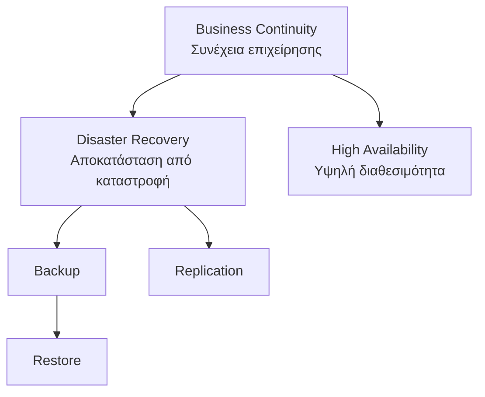

# 1. Τι είναι το backup και γιατί χρειάζεται

> **Σύνοψη:** Το backup είναι ανεξάρτητο αντίγραφο δεδομένων που φυλάσσεται για να μπορούμε να τα επαναφέρουμε όταν χαθούν, καταστραφούν ή αλλοιωθούν. Η αξία του κρίνεται από την ικανότητα **επαναφοράς** και όχι από την ικανότητα αποθήκευσης.

---

## 1.1 Ορισμός

**Backup (αντίγραφο ασφαλείας)** είναι ένα ανεξάρτητο αντίγραφο δεδομένων, που φυλάσσεται ώστε να μπορούμε να τα **επαναφέρουμε (restore)** αν χαθούν, καταστραφούν ή αλλοιωθούν.

## 1.2 Γιατί χάνονται δεδομένα

| Αιτία | Παράδειγμα | Συχνότητα στην πράξη |
| --- | --- | --- |
| **Ανθρώπινο λάθος** | Διαγραφή φακέλου, λάθος `rm -rf`, αντικατάσταση αρχείου | Πολύ συχνό |
| **Βλάβη hardware** | Χαλασμένος δίσκος, RAID controller, τροφοδοτικό | Συχνό |
| **Σφάλμα λογισμικού / ενημέρωσης** | Προβληματικό update, corrupt βάση δεδομένων | Συχνό |
| **Ransomware / κακόβουλο λογισμικό** | Κρυπτογράφηση αρχείων και backups | Αυξανόμενο, υψηλός αντίκτυπος |
| **Κακόβουλος εσωτερικός χρήστης** | Δυσαρεστημένος υπάλληλος διαγράφει δεδομένα | Σπάνιο, σοβαρό |
| **Κλοπή** | Κλοπή laptop ή server | Μεσαίο |
| **Φυσικές καταστροφές** | Πυρκαγιά, πλημμύρα, σεισμός, διακοπή ρεύματος | Σπάνιο, καταστροφικό |
| **Σφάλμα παρόχου cloud** | Διαγραφή λογαριασμού, outage | Σπάνιο |

## 1.3 Η βασική αρχή

> **Ένα backup που δεν έχει δοκιμαστεί σε restore δεν είναι backup. Είναι ελπίδα.**

Το backup δεν αξιολογείται με το πόσο καλά αποθηκεύει, αλλά με το πόσο **γρήγορα και σωστά επαναφέρει**.

## 1.4 Τι δεν αποτελεί backup

| Λύση | Γιατί δεν αρκεί |
| --- | --- |
| **RAID** | Προστατεύει από βλάβη δίσκου, όχι από διαγραφή, corruption ή ransomware. Η διαγραφή αντιγράφεται άμεσα στους υπόλοιπους δίσκους. |
| **Συγχρονισμός** (OneDrive, Dropbox, Google Drive) | Αν ένα αρχείο διαγραφεί ή κρυπτογραφηθεί, η αλλαγή συγχρονίζεται παντού. Το version history είναι περιορισμένο και δεν αντικαθιστά backup. |
| **Snapshot στον ίδιο αποθηκευτικό χώρο** | Αν χαθεί το storage, χάνονται μαζί και τα snapshots. |
| **Δεύτερο αντίγραφο στον ίδιο δίσκο** | Προστατεύει μόνο από κατά λάθος διαγραφή. |

---

# 2. Βασικοί όροι και διαφορές εννοιών

| Όρος | Τι είναι | Παράδειγμα |
| --- | --- | --- |
| **Backup** | Αντίγραφο σε συγκεκριμένο χρονικό σημείο, ξεχωριστό από την πηγή | Νυχτερινό αντίγραφο του file server |
| **Restore / Recovery** | Επαναφορά δεδομένων από backup | Επαναφορά διαγραμμένου αρχείου |
| **Archive (αρχειοθέτηση)** | Μακροχρόνια φύλαξη δεδομένων που δεν χρειάζονται συχνά, συνήθως για νομικούς λόγους | Λογιστικά αρχεία 10 ετών |
| **Snapshot** | Στιγμιότυπο της κατάστασης δίσκου / VM / volume, συνήθως στο ίδιο storage | VMware snapshot, ZFS snapshot, VSS |
| **Replication** | Συνεχής ή περιοδική αντιγραφή δεδομένων σε άλλο σύστημα, για γρήγορο failover | Hyper-V Replica, Veeam Replication |
| **High Availability (HA)** | Σχεδιασμός ώστε η υπηρεσία να μη σταματά σε βλάβη ενός κόμβου | Cluster 2 κόμβων |
| **Disaster Recovery (DR)** | Σχέδιο και τεχνολογία για επαναφορά υπηρεσιών μετά από μεγάλη καταστροφή | Επαναφορά σε δεύτερο site |
| **Business Continuity (BC)** | Ευρύτερο σχέδιο συνέχισης της επιχείρησης (άνθρωποι, διαδικασίες, χώροι, IT) | BCP εταιρείας |
| **Failover** | Μετάβαση της υπηρεσίας στο εφεδρικό σύστημα | Μετάβαση στο DR site |
| **Failback** | Επιστροφή στο αρχικό σύστημα μετά την αποκατάσταση | Επιστροφή στο κύριο datacenter |

## 2.1 Σχέση των εννοιών

> **Απλή σύνοψη:** Το backup είναι **το υλικό**, το DR είναι **το σχέδιο**, το BC είναι **η συνολική στρατηγική**.

---

[📚 Περιεχόμενα](./README.md) | [Επόμενο ➡️](./02-RPO-RTO.md)
