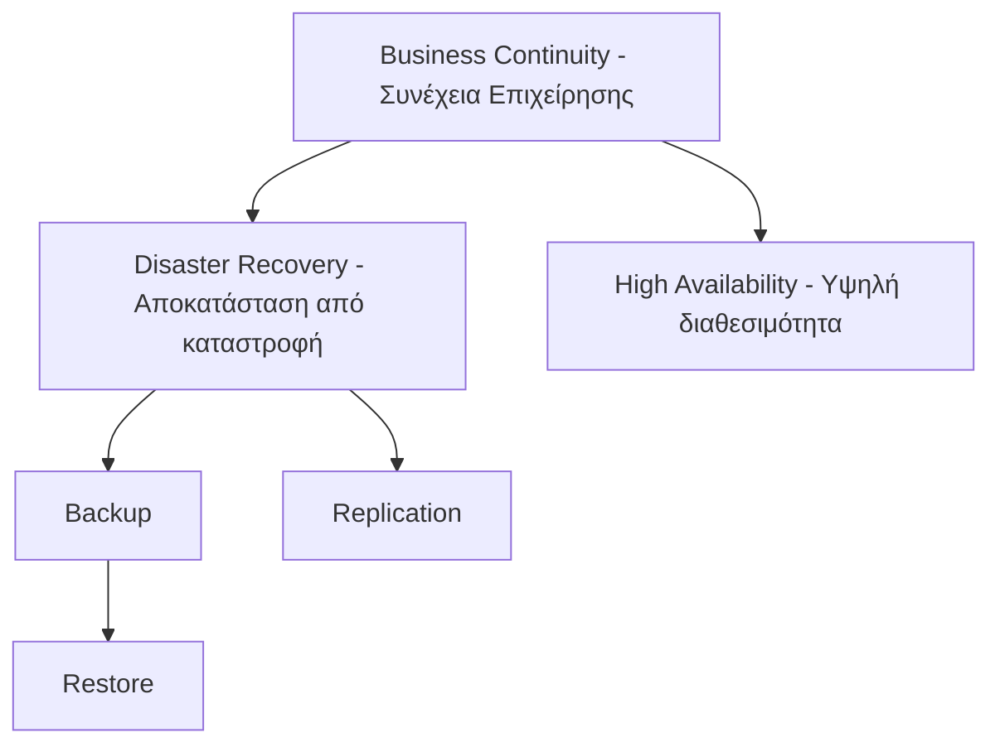

# 1. Τι είναι το backup και γιατί χρειάζεται

**Backup (αντίγραφο ασφαλείας)** είναι ένα ανεξάρτητο αντίγραφο δεδομένων, που φυλάσσεται ώστε να μπορούμε να τα **επαναφέρουμε (restore)** αν χαθούν, καταστραφούν ή αλλοιωθούν.

### Γιατί χάνονται δεδομένα;

| Αιτία | Παράδειγμα | Περίπου συχνότητα στην πράξη |
|---|---|---|
| **Ανθρώπινο λάθος** | Διαγραφή φακέλου, λάθος `rm -rf`, αντικατάσταση αρχείου | Πολύ συχνό |
| **Βλάβη hardware** | Χαλασμένος δίσκος, RAID controller, τροφοδοτικό | Συχνό |
| **Ransomware / κακόβουλο λογισμικό** | Κρυπτογράφηση αρχείων και backup | Αυξανόμενο, υψηλός αντίκτυπος |
| **Σφάλμα λογισμικού / ενημέρωση** | Κακό update, corrupt βάση δεδομένων | Συχνό |
| **Κακόβουλος εσωτερικός χρήστης** | Εξαγριωμένος υπάλληλος διαγράφει δεδομένα | Σπάνιο, σοβαρό |
| **Φυσικές καταστροφές** | Πυρκαγιά, πλημμύρα, σεισμός, διακοπή ρεύματος | Σπάνιο, καταστροφικό |
| **Κλοπή** | Κλοπή laptop ή server | Μεσαίο |
| **Σφάλμα παρόχου cloud** | Διαγραφή λογαριασμού, outage | Σπάνιο |

### Η βασική αρχή

> **Ένα backup που δεν έχει δοκιμαστεί σε restore, δεν είναι backup. Είναι ελπίδα.**

Το backup δεν αποτιμάται με το πόσο καλά αποθηκεύει, αλλά με το πόσο **γρήγορα και σωστά επαναφέρει**.

### Τι δεν είναι backup

- ❌ **RAID** – προστατεύει από βλάβη δίσκου, όχι από διαγραφή, corruption ή ransomware (η διαγραφή αντιγράφεται άμεσα).
- ❌ **Συγχρονισμός (OneDrive/Dropbox/Google Drive sync)** – αν διαγράψεις ή κρυπτογραφηθεί ένα αρχείο, η αλλαγή συγχρονίζεται παντού. (Έχουν περιορισμένο version history, αλλά δεν αντικαθιστούν backup.)
- ❌ **Snapshot στον ίδιο αποθηκευτικό χώρο** – αν χαθεί ο χώρος, χάνονται και τα snapshots.
- ❌ **Δεύτερο αντίγραφο στον ίδιο δίσκο** – προστατεύει μόνο από λάθος διαγραφής.

---

# 2. Βασικοί όροι και διαφορές εννοιών

| Όρος | Τι είναι | Παράδειγμα |
|---|---|---|
| **Backup** | Αντίγραφο σε συγκεκριμένο χρονικό σημείο, ξεχωριστό από την πηγή | Νυχτερινό αντίγραφο του file server |
| **Restore / Recovery** | Επαναφορά δεδομένων από backup | Επαναφορά διαγραμμένου αρχείου |
| **Archive (αρχειοθέτηση)** | Μακροχρόνια φύλαξη δεδομένων που δεν χρειάζονται συχνά, συνήθως για νομικούς λόγους | Λογιστικά αρχεία 10 ετών |
| **Snapshot** | Στιγμιότυπο της κατάστασης ενός δίσκου/VM/volume, συνήθως στο ίδιο storage | VMware snapshot, ZFS snapshot, VSS |
| **Replication (αντιγραφή)** | Συνεχής ή περιοδική αντιγραφή δεδομένων σε άλλο σύστημα, για γρήγορο failover | Hyper-V Replica, Veeam Replication |
| **High Availability (HA)** | Σχεδιασμός ώστε η υπηρεσία να μη σταματά σε βλάβη ενός κόμβου | Cluster 2 κόμβων |
| **Disaster Recovery (DR)** | Σχέδιο και τεχνολογία για επαναφορά υπηρεσιών μετά από μεγάλη καταστροφή | Επαναφορά σε δεύτερο site |
| **Business Continuity (BC)** | Ευρύτερο σχέδιο ώστε η επιχείρηση να συνεχίσει να λειτουργεί (άνθρωποι, διαδικασίες, χώροι, IT) | BCP εταιρείας |
| **Failover** | Μετάβαση της υπηρεσίας στο εφεδρικό σύστημα | Μετάβαση στο DR site |
| **Failback** | Επιστροφή στο αρχικό σύστημα μετά την αποκατάσταση | Επιστροφή στο κύριο datacenter |

### Σχέση των εννοιών

**Απλή σύνοψη:** Το backup είναι **το υλικό**, το DR είναι **το σχέδιο**, το BC είναι **η ολική στρατηγική**.

---

[📚 Περιεχόμενα](README.md) | [Επόμενο ➡️](02-RPO-RTO.md)
