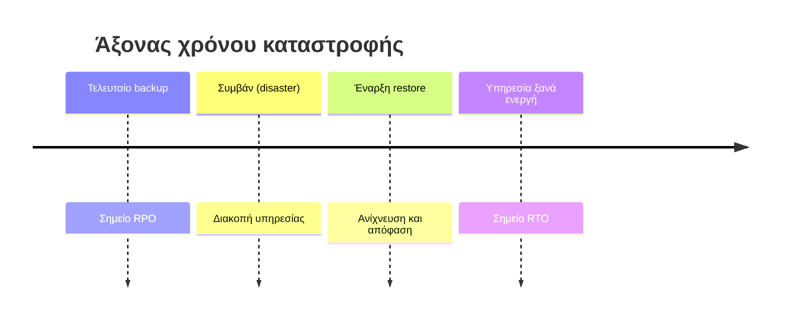

# 3. RPO, RTO και συναφείς δείκτες

Αυτοί οι δείκτες καθορίζουν **πόσο συχνά** κάνεις backup και **τι τεχνολογία** χρειάζεσαι. Τους ορίζει η **επιχείρηση**, όχι το IT.

### RPO – Recovery Point Objective
**«Πόση ποσότητα δεδομένων (σε χρόνο) μπορούμε να χάσουμε;»**

Είναι η μέγιστη αποδεκτή απώλεια δεδομένων, μετρημένη σε χρόνο **πριν** το συμβάν.

- Backup κάθε νύχτα στις 02:00 → στη χειρότερη περίπτωση (βλάβη στις 01:59) χάνεις σχεδόν **24 ώρες** → RPO ≈ 24 ώρες.
- Backup κάθε ώρα → RPO ≈ 1 ώρα.
- Συνεχής αντιγραφή (CDP, synchronous replication) → RPO ≈ δευτερόλεπτα ή 0.

### RTO – Recovery Time Objective
**«Πόσο γρήγορα πρέπει να ξαναλειτουργήσει η υπηρεσία;»**

Είναι ο μέγιστος αποδεκτός χρόνος διακοπής (downtime), από το συμβάν μέχρι την επαναφορά.

- Restore από ταινία + εγκατάσταση νέου server → RTO: ώρες ή ημέρες.
- Veeam Instant Recovery από repository → RTO: λεπτά.
- Hot standby με replication → RTO: δευτερόλεπτα έως λεπτά.



```
        <------ RPO ------>|<-------------- RTO -------------->
  Τελευταίο backup      ΣΥΜΒΑΝ                          Υπηρεσία ξανά ενεργή
  ------------------------X-----------------------------------▶ χρόνος
        (χαμένα δεδομένα)     (χαμένος χρόνος / downtime)
```

### Άλλοι σημαντικοί δείκτες

| Δείκτης | Ονομασία | Σημασία |
|---|---|---|
| **MTD / MAO** | Maximum Tolerable Downtime / Maximum Acceptable Outage | Ο απόλυτος χρόνος διακοπής πέρα από τον οποίο η επιχείρηση κινδυνεύει σοβαρά. **RTO + WRT ≤ MTD** |
| **WRT** | Work Recovery Time | Χρόνος μετά την τεχνική επαναφορά για έλεγχο, επαλήθευση δεδομένων, επανέναρξη εργασιών |
| **MTBF** | Mean Time Between Failures | Μέσος χρόνος μεταξύ βλαβών |
| **MTTR** | Mean Time To Repair | Μέσος χρόνος επισκευής |
| **RTA / RPA** | Recovery Time / Point **Actual** | Τι πέτυχες **πραγματικά** σε δοκιμή (πρέπει να είναι ≤ RTO/RPO) |

### Παράδειγμα καταγραφής ανά σύστημα

| Σύστημα | Κρισιμότητα | RPO | RTO | Συνέπεια μιας ώρας διακοπής |
|---|---|---|---|---|
| E-shop (βάση δεδομένων) | Κρίσιμο | 5 λεπτά | 30 λεπτά | Άμεση απώλεια εσόδων |
| Active Directory | Κρίσιμο | 4 ώρες | 2 ώρες | Κανείς δεν μπορεί να συνδεθεί |
| File server | Σημαντικό | 24 ώρες | 8 ώρες | Καθυστέρηση εργασιών |
| Email | Σημαντικό | 1 ώρα | 4 ώρες | Διακοπή επικοινωνίας |
| Dev/Test server | Χαμηλό | 7 ημέρες | 3 ημέρες | Ελάχιστη |

### Κανόνας κόστους

> Όσο **μικρότερα** RPO/RTO, τόσο **ακριβότερη** η λύση (πιο πολύ storage, bandwidth, άδειες, πολυπλοκότητα). Γι' αυτό **δεν προστατεύουμε τα πάντα το ίδιο**· ταξινομούμε σε βαθμίδες (tiers).

| Tier | Τύπος | Τυπικό RPO / RTO | Τυπική τεχνολογία |
|---|---|---|---|
| **Tier 0** | Mission critical | ~0 / λεπτά | Synchronous replication, cluster, active-active |
| **Tier 1** | Πολύ σημαντικό | Λεπτά / <1–2 ώρες | Replication, συχνά backup, instant recovery |
| **Tier 2** | Σημαντικό | Ώρες / ώρες | Καθημερινό backup, restore από repository |
| **Tier 3** | Χαμηλής κρισιμότητας | 1 ημέρα+ / ημέρες | Εβδομαδιαίο backup |

---

[⬅️ Προηγούμενο](01-Eisagogi-kai-Vasikes-Ennoies.md) | [📚 Περιεχόμενα](README.md) | [Επόμενο ➡️](03-Strategiki-3-2-1.md)
