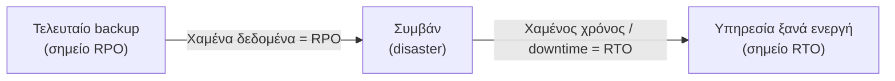

# 3. RPO, RTO και συναφείς δείκτες

> **Σύνοψη:** Οι δείκτες RPO και RTO καθορίζουν *πόσο συχνά* λαμβάνονται αντίγραφα ασφαλείας και *ποια τεχνολογία* απαιτείται για την επαναφορά. Ορίζονται από την **επιχείρηση** και όχι από το τμήμα IT. Το IT τους μετατρέπει σε τεχνική υλοποίηση.

---

## 3.1 RPO – Recovery Point Objective

**Ερώτημα που απαντά:** *«Πόσα δεδομένα (εκφρασμένα σε χρόνο) μπορούμε να αντέξουμε να χάσουμε;»*

Το RPO είναι η **μέγιστη αποδεκτή απώλεια δεδομένων**, μετρημένη σε χρόνο **πριν** από το συμβάν.

| Μηχανισμός προστασίας | Χειρότερο σενάριο | Αντίστοιχο RPO |
| --- | --- | --- |
| Backup κάθε νύχτα στις 02:00 | Βλάβη στις 01:59, χάνονται σχεδόν 24 ώρες | ≈ 24 ώρες |
| Backup κάθε ώρα | Βλάβη λίγο πριν το επόμενο backup | ≈ 1 ώρα |
| Συνεχής αντιγραφή (CDP, synchronous replication) | Χάνονται μόνο οι εγγραφές των τελευταίων δευτερολέπτων | ≈ δευτερόλεπτα ή 0 |

## 3.2 RTO – Recovery Time Objective

**Ερώτημα που απαντά:** *«Πόσο γρήγορα πρέπει να επανέλθει η υπηρεσία;»*

Το RTO είναι ο **μέγιστος αποδεκτός χρόνος διακοπής (downtime)**, από τη στιγμή του συμβάντος έως την πλήρη επαναφορά της υπηρεσίας.

| Μέθοδος επαναφοράς | Τυπικό RTO |
| --- | --- |
| Restore από ταινία και εγκατάσταση νέου server | Ώρες έως ημέρες |
| Veeam Instant Recovery από repository | Λεπτά |
| Hot standby με replication | Δευτερόλεπτα έως λεπτά |

## 3.3 Σχέση RPO και RTO στον άξονα του χρόνου



```text
        <------ RPO ------>|<-------------- RTO -------------->
  Τελευταίο backup       ΣΥΜΒΑΝ                       Υπηρεσία ξανά ενεργή
  ------------------------X--------------------------------▶ χρόνος
        (χαμένα δεδομένα)      (χαμένος χρόνος / downtime)
```

## 3.4 Άλλοι σημαντικοί δείκτες

| Δείκτης | Πλήρης ονομασία | Σημασία |
| --- | --- | --- |
| **MTD / MAO** | Maximum Tolerable Downtime / Maximum Acceptable Outage | Ο απόλυτος χρόνος διακοπής, πέρα από τον οποίο η επιχείρηση κινδυνεύει σοβαρά. Ισχύει: **RTO + WRT ≤ MTD** |
| **WRT** | Work Recovery Time | Ο χρόνος μετά την τεχνική επαναφορά, για έλεγχο, επαλήθευση δεδομένων και επανέναρξη εργασιών |
| **MTBF** | Mean Time Between Failures | Μέσος χρόνος μεταξύ βλαβών |
| **MTTR** | Mean Time To Repair | Μέσος χρόνος επισκευής |
| **RTA / RPA** | Recovery Time / Point **Actual** | Ό,τι επιτεύχθηκε **πραγματικά** σε δοκιμή. Πρέπει να είναι ≤ RTO / RPO |

## 3.5 Παράδειγμα καταγραφής ανά σύστημα

| Σύστημα | Κρισιμότητα | RPO | RTO | Συνέπεια μίας ώρας διακοπής |
| --- | --- | --- | --- | --- |
| E-shop (βάση δεδομένων) | Κρίσιμο | 5 λεπτά | 30 λεπτά | Άμεση απώλεια εσόδων |
| Active Directory | Κρίσιμο | 4 ώρες | 2 ώρες | Κανείς δεν μπορεί να συνδεθεί |
| File server | Σημαντικό | 24 ώρες | 8 ώρες | Καθυστέρηση εργασιών |
| Email | Σημαντικό | 1 ώρα | 4 ώρες | Διακοπή επικοινωνίας |
| Dev/Test server | Χαμηλό | 7 ημέρες | 3 ημέρες | Ελάχιστη |

## 3.6 Κανόνας κόστους και βαθμίδες προστασίας (tiers)

> Όσο **μικρότερα** είναι τα RPO/RTO, τόσο **ακριβότερη** είναι η λύση (περισσότερο storage, bandwidth, άδειες και πολυπλοκότητα). Για τον λόγο αυτό **δεν προστατεύουμε τα πάντα με τον ίδιο τρόπο**. Τα συστήματα ταξινομούνται σε βαθμίδες (tiers).

| Tier | Τύπος | Τυπικό RPO / RTO | Τυπική τεχνολογία |
| --- | --- | --- | --- |
| **Tier 0** | Mission critical | ~0 / λεπτά | Synchronous replication, cluster, active-active |
| **Tier 1** | Πολύ σημαντικό | Λεπτά / < 1–2 ώρες | Replication, συχνό backup, instant recovery |
| **Tier 2** | Σημαντικό | Ώρες / ώρες | Καθημερινό backup, restore από repository |
| **Tier 3** | Χαμηλής κρισιμότητας | 1 ημέρα+ / ημέρες | Εβδομαδιαίο backup |

---

[⬅️ Προηγούμενο](./01-Eisagogi-kai-Vasikes-Ennoies.md) | [📚 Περιεχόμενα](./README.md) | [Επόμενο ➡️](./03-Strategiki-3-2-1.md)
