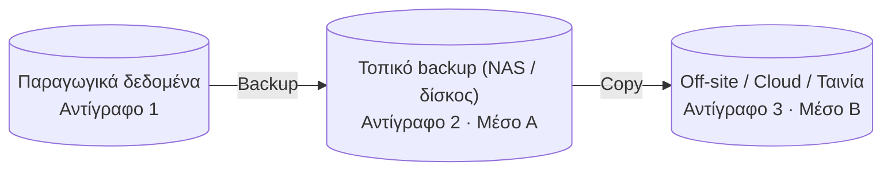

# 4. Η στρατηγική 3-2-1 και οι παραλλαγές της

> **Σύνοψη:** Ο κανόνας 3-2-1 είναι η βασική αρχή σχεδιασμού αντιγράφων ασφαλείας. Εξασφαλίζει ότι μία μεμονωμένη βλάβη, ένα συμβάν στο χώρο ή μια επίθεση δεν μπορεί να καταστρέψει όλα τα αντίγραφα.

---

## 4.1 Ο κανόνας 3-2-1

| Αριθμός | Απαίτηση |
| :---: | --- |
| **3** | Τρία αντίγραφα των δεδομένων (1 παραγωγικό + 2 backups) |
| **2** | Δύο διαφορετικά μέσα ή τεχνολογίες αποθήκευσης |
| **1** | Ένα αντίγραφο **εκτός τοποθεσίας** (off-site) |

## 4.2 Γιατί λειτουργεί

- Μία βλάβη δεν αρκεί για να καταστραφούν όλα τα αντίγραφα.
- Διαφορετικά μέσα σημαίνουν διαφορετικούς τρόπους αποτυχίας.
- Το off-site αντίγραφο προστατεύει από πυρκαγιά, πλημμύρα, κλοπή και από ransomware που εξαπλώνεται σε όλο το τοπικό δίκτυο.

## 4.3 Παραλλαγές

| Κανόνας | Σημασία |
| --- | --- |
| **3-2-1** | Η κλασική βάση |
| **3-2-1-1-0** | Επιπλέον: **1** αντίγραφο **offline / air-gapped / immutable** και **0** σφάλματα μετά από επαλήθευση (verification) |
| **4-3-2** | 4 αντίγραφα, 3 τοποθεσίες, 2 off-site (για μεγάλους οργανισμούς) |

## 4.4 Τι σημαίνει «offline / immutable / 0 errors»

| Όρος | Ορισμός |
| --- | --- |
| **Air-gapped** | Το αντίγραφο δεν είναι συνδεδεμένο στο δίκτυο (π.χ. αποσυνδεδεμένος δίσκος, ταινία στο ράφι). |
| **Immutable** | Το αντίγραφο **δεν μπορεί να τροποποιηθεί ή να διαγραφεί** για ορισμένο χρόνο, ούτε από διαχειριστή (π.χ. S3 Object Lock, Veeam Hardened Repository, WORM storage). |
| **0 errors** | Γίνεται αυτοματοποιημένος έλεγχος restore (π.χ. Veeam SureBackup, `restic check`) που επιβεβαιώνει ότι τα backups λειτουργούν. |

## 4.5 Παράδειγμα για μικρό γραφείο (περίπου 10 χρήστες)

| Αντίγραφο | Θέση | Υλοποίηση |
| --- | --- | --- |
| 1. Παραγωγικό | File server | – |
| 2. Τοπικό backup | USB / NAS δίσκος | Windows Server Backup ή Veeam, καθημερινά |
| 3. Off-site / cloud | Backblaze B2 / Azure Blob / S3 | restic ή Veeam Backup Copy, κρυπτογραφημένο |
| (+1) Offline | Εναλλασσόμενοι εξωτερικοί δίσκοι (εβδομαδιαία) | Φύλαξη εκτός γραφείου |

---

[⬅️ Προηγούμενο](./02-RPO-RTO.md) | [📚 Περιεχόμενα](./README.md) | [Επόμενο ➡️](./04-Typoi-Backup.md)
