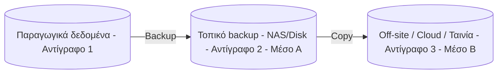

# 4. Η στρατηγική 3-2-1 (και οι παραλλαγές της)

### Ο κανόνας 3-2-1

- **3** αντίγραφα των δεδομένων (1 παραγωγικό + 2 backups)
- **2** διαφορετικά μέσα/τεχνολογίες αποθήκευσης
- **1** αντίγραφο **εκτός τοποθεσίας** (off-site)

### Γιατί λειτουργεί
- Μία βλάβη δεν αρκεί να καταστρέψει όλα τα αντίγραφα.
- Διαφορετικά μέσα → διαφορετικοί τρόποι αποτυχίας.
- Το off-site προστατεύει από πυρκαγιά, πλημμύρα, κλοπή, ransomware που φτάνει σε όλο το τοπικό δίκτυο.

### Παραλλαγές

| Κανόνας | Σημασία |
|---|---|
| **3-2-1** | Η κλασική βάση |
| **3-2-1-1-0** | Επιπλέον: **1** αντίγραφο **offline / air-gapped / immutable** και **0** σφάλματα μετά από επαλήθευση (verification) |
| **4-3-2** | 4 αντίγραφα, 3 τοποθεσίες, 2 off-site (για μεγάλους οργανισμούς) |

### Τι σημαίνει «offline / immutable»
- **Air-gapped:** το αντίγραφο δεν είναι συνδεδεμένο στο δίκτυο (π.χ. αποσυνδεδεμένος δίσκος, ταινία στο ράφι).
- **Immutable:** το αντίγραφο **δεν μπορεί να τροποποιηθεί ή να διαγραφεί** για ορισμένο χρόνο, ούτε από διαχειριστή (π.χ. S3 Object Lock, Veeam Hardened Repository, WORM storage).
- **«0 errors»:** κάνεις αυτοματοποιημένο έλεγχο restore (π.χ. Veeam SureBackup, `restic check`) και επιβεβαιώνεις ότι τα backups δουλεύουν.

### Παράδειγμα για μικρό γραφείο (π.χ. 10 χρήστες)

| Αντίγραφο | Που | Πώς |
|---|---|---|
| 1. Παραγωγικό | File server | – |
| 2. Τοπικό backup | USB/NAS δίσκος | Windows Server Backup ή Veeam, καθημερινά |
| 3. Off-site / cloud | Backblaze B2 / Azure Blob / S3 | restic ή Veeam Backup Copy, κρυπτογραφημένο |
| (+1) Offline | Εναλλασσόμενοι εξωτερικοί δίσκοι (εβδομαδιαία) | Αποθήκευση εκτός γραφείου |

---

[⬅️ Προηγούμενο](02-RPO-RTO.md) | [📚 Περιεχόμενα](README.md) | [Επόμενο ➡️](04-Typoi-Backup.md)
