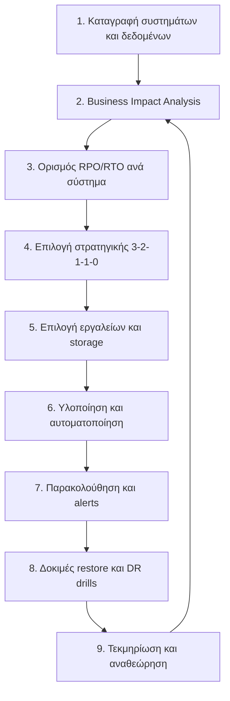

# 10. Σχεδιασμός backup: από τις απαιτήσεις στην υλοποίηση

### Βήματα

### Πίνακας σχεδιασμού (παράδειγμα συμπλήρωσης)

| Σύστημα | Δεδομένα | Όγκος | RPO | RTO | Εργαλείο | Συχνότητα | Retention | Off-site | Ιδιοκτήτης |
|---|---|---|---|---|---|---|---|---|---|
| DC01 (AD) | System State + VM | 80 GB | 4 ώρες | 2 ώρες | WSB / Veeam | Κάθε 4 ώρες | 30 ημ. | Ναι | IT Admin |
| FS01 | Shares D:\ | 2 TB | 24 ώρες | 8 ώρες | Veeam | Καθημερινά | GFS | Ναι | IT Admin |
| WEB01 (Linux) | /etc, /var/www | 50 GB | 24 ώρες | 4 ώρες | restic | Καθημερινά | 7d/4w/6m | S3 | DevOps |
| SQL01 | DB + logs | 500 GB | 15 λεπτά | 1 ώρα | Veeam + log backup | 15 λεπτά | 14 ημ. | Ναι | DBA |

### Αυτοματοποίηση και παρακολούθηση

- Όλα τα backups να τρέχουν **με schedule** (Task Scheduler, cron, systemd timers, Veeam scheduler).
- Ειδοποιήσεις email/Teams/Slack για **αποτυχία** και **προειδοποίηση**.
- Εβδομαδιαία **αναφορά κατάστασης** (success/fail, μέγεθος, διάρκεια).
- **Παρακολούθηση χώρου** του repository (alert στο 80%).

---

[⬅️ Προηγούμενο](07-Asfaleia-Ransomware.md) | [📚 Περιεχόμενα](README.md) | [Επόμενο ➡️](09-Disaster-Recovery-Plan.md)
