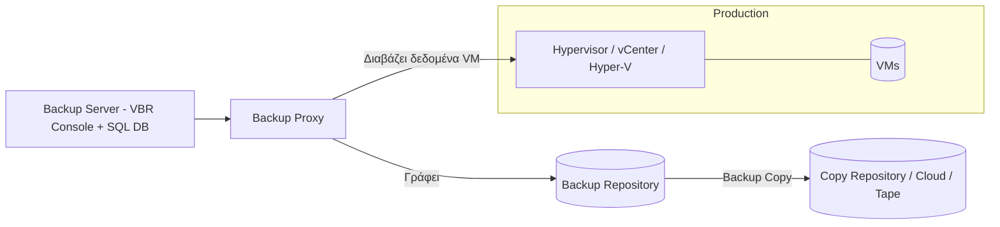

# 13. Veeam Backup & Replication

### 13.1 Τι είναι
Το **Veeam Backup & Replication (VBR)** είναι από τα πιο διαδεδομένα enterprise εργαλεία backup για **VMware vSphere, Microsoft Hyper-V, Nutanix AHV, Proxmox** (ανάλογα έκδοση), φυσικούς servers (Veeam Agent για Windows/Linux), file shares, και cloud workloads.

> Η έκδοση και οι ακριβείς δυνατότητες εξαρτώνται από την άδεια (Community / Foundation / Advanced / Universal). Υπάρχει **Community Edition** για περιορισμένο αριθμό workloads, ιδανική για εκμάθηση και lab. Έλεγξε πάντα την τρέχουσα τεκμηρίωση και όρους στο [veeam.com](https://www.veeam.com).

### 13.2 Αρχιτεκτονική – οι βασικές συνιστώσες

| Συνιστώσα | Ρόλος |
|---|---|
| **Backup Server** | Ο «εγκέφαλος»: διαχείριση jobs, schedules, configuration, βάση δεδομένων (PostgreSQL ή SQL Server ανάλογα έκδοση) |
| **Veeam Console** | Γραφική διεπαφή διαχείρισης (και Web UI σε νεότερες εκδόσεις) |
| **Backup Proxy** | Μετακινεί δεδομένα από την πηγή στο repository (επεξεργασία, συμπίεση, dedup, κρυπτογράφηση) |
| **Backup Repository** | Ο χώρος αποθήκευσης των backups (Windows/Linux server, NAS, SMB share, dedup appliance, object storage) |
| **Scale-Out Backup Repository (SOBR)** | Ομαδοποίηση repositories σε tiers: Performance → Capacity → Archive |
| **Mount Server** | Χρησιμοποιείται για file-level και application-item restore |
| **Guest Interaction Proxy / Gateway Server** | Ειδικοί ρόλοι για guest OS και cloud/NAS |
| **Hardened Repository** | Linux repository με **immutability** (δεν διαγράφεται από hackers ή διαχειριστές) |

### 13.3 Προαπαιτούμενα και σχεδιασμός εγκατάστασης

- **Backup Server:** Windows Server (σύμφωνα με system requirements της έκδοσης), CPU/RAM ανάλογα με τα jobs (π.χ. 4 vCPU / 8–16 GB RAM για lab).
- **Βάση δεδομένων:** Η έκδοση συνοδεύεται από ενσωματωμένη βάση (PostgreSQL σε v12+ για νέες εγκαταστάσεις). Για μεγάλα περιβάλλοντα εξωτερικός SQL/PostgreSQL.
- **Repository:** Ξεχωριστός δίσκος/volume (τοπικά, NAS, Linux Hardened). Προτείνεται **ReFS** (Windows) ή **XFS** με reflink (Linux) για **fast clone** (ταχύτερα synthetic fulls, εξοικονόμηση χώρου).
- **Δίκτυο:** Αρκετό εύρος ζώνης· ιδανικά ξεχωριστό VLAN για backup.
- **Λογαριασμοί:** Ξεχωριστοί service accounts με ελάχιστα δικαιώματα.
- **Ασφάλεια:** Ο backup server προτείνεται να είναι **εκτός παραγωγικού domain** ή σε ειδικό management domain, ενημερωμένος και με MFA.

### 13.4 Εγκατάσταση (περίληψη βημάτων)

1. Κατέβασμα ISO από το Veeam (απαιτείται δωρεάν λογαριασμός).
2. Mount ISO στον Windows Server και εκτέλεση **Setup**.
3. **Install Veeam Backup & Replication** → αποδοχή αδειών → επιλογή άδειας (`.lic`) ή Community.
4. Επιλογή φακέλου εγκατάστασης και service account.
5. Εγκατάσταση prerequisites και βάσης.
6. Άνοιγμα **Veeam Backup & Replication Console**.

### 13.5 Αρχική ρύθμιση

1. **Προσθήκη διακομιστή πηγής:** *Backup Infrastructure → Managed Servers → Add Server* (vCenter, ESXi, Hyper-V host, Windows/Linux server).
2. **Δημιουργία Repository:** *Backup Infrastructure → Backup Repositories → Add Repository* → Directly attached storage / Network attached storage / Object storage / Hardened Repository.
3. **Προσθήκη Proxy** (προαιρετικό σε μικρά περιβάλλοντα· ο backup server λειτουργεί και ως proxy).
4. **Διαπιστευτήρια:** *Credentials and Passwords* (αποθήκευση λογαριασμών για πρόσβαση σε VMs).
5. **Ρύθμιση ειδοποιήσεων email:** *Main Menu → General Options → E-mail Settings*.
6. **Ρύθμιση κρυπτογράφησης:** *Password Manager* για encryption keys (και backup του configuration!).

### 13.6 Τύποι εργασιών (Jobs)

| Job | Σκοπός |
|---|---|
| **Backup Job (VM)** | Backup VMs (VMware, Hyper-V…) |
| **Agent Backup Job** | Backup φυσικών servers/workstations (Veeam Agent for Windows/Linux) |
| **File Backup / NAS Backup** | Backup SMB/NFS shares και object storage |
| **Backup Copy Job** | Αντιγραφή backups σε δεύτερο repository / cloud (το «2» και «1» του 3-2-1) |
| **Replication Job** | Συγχρονισμός VM σε άλλο host/site (για γρήγορο failover) |
| **CDP (Continuous Data Protection)** | Συνεχής προστασία VMware VMs (RPO δευτερολέπτων) |
| **SureBackup Job** | Αυτόματη δοκιμή restore σε isolated lab (virtual lab) |
| **Tape Job** | Backup σε ταινίες |
| **Configuration Backup** | Backup της ίδιας της διαμόρφωσης του Veeam |

### 13.7 Δημιουργία Backup Job (VM) – βήμα βήμα

1. *Home → Backup Job → Virtual Machine → VMware vSphere / Hyper-V*.
2. **Name:** π.χ. `Prod-VMs-Daily`.
3. **Virtual Machines:** επιλογή VMs, φακέλων ή tags (προτιμήστε **tags/folders** για αυτόματη ένταξη νέων VMs).
4. **Storage:** επιλογή repository, **Retention policy** (π.χ. 14 restore points), **GFS retention** (weekly/monthly/yearly), κουμπί **Advanced**.
5. **Advanced Settings:**
   - *Backup mode:* Forward incremental (προτείνεται) / Reverse incremental
   - *Active full / Synthetic full:* π.χ. weekly synthetic full
   - *Compression & Deduplication:* Optimal / High
   - *Encryption:* ✅ ενεργοποίηση με password
   - *Maintenance:* Health check (αυτόματος έλεγχος ακεραιότητας), defragment/compact
6. **Guest Processing:**
   - ✅ **Application-aware processing** (VSS για SQL, Exchange, AD)
   - ✅ **Guest file system indexing** (για γρήγορη αναζήτηση αρχείων)
   - Διαπιστευτήρια guest
   - Truncate logs (SQL/Exchange) αν επιθυμείτε
7. **Schedule:** π.χ. καθημερινά στις 22:00, με retry σε αποτυχία.
8. Finish → *Run the job when I click Finish* → έλεγχος **Success**.

### 13.8 Τύποι επαναφοράς (Restore)

| Τύπος | Πότε | Περιγραφή |
|---|---|---|
| **Instant Recovery** | Πέφτει VM και χρειάζεται άμεση λειτουργία | Η VM **εκκινεί απευθείας από το backup** (σε δευτερόλεπτα/λεπτά)· μετά μεταφέρεται στην παραγωγή (*Storage vMotion* / *Quick Migration*) |
| **Full VM Restore** | Ολική επαναφορά VM | Επαναφορά σε αρχική ή νέα θέση |
| **Guest Files Restore** | Επαναφορά αρχείων | Αναζήτηση και επαναφορά αρχείου από VM χωρίς να επαναφέρεις όλη τη VM |
| **Application Items Restore** | Επαναφορά items εφαρμογής | **Veeam Explorers**: Active Directory (αντικείμενα), Exchange (mailboxes/emails), SQL (βάσεις/πίνακες), SharePoint, Oracle, PostgreSQL |
| **Disk Restore (VMDK/VHDX)** | Επαναφορά μεμονωμένου δίσκου | Δημιουργία δίσκου και attach |
| **Restore to Azure/AWS** | Μετάβαση σε cloud | DR ή migration |
| **Bare Metal Restore (Agent)** | Φυσικός server | Εκκίνηση από **Veeam Recovery Media (ISO/USB)** |
| **Secure Restore** | Έλεγχος για malware | Σάρωση με antivirus **πριν** επαναφέρεις |
| **Export Disks / Publish Disks** | Ανάκτηση δεδομένων χωρίς πλήρες restore | Προσάρτηση δίσκου από backup |

**Παράδειγμα – επαναφορά διαγραμμένου αρχείου:**
1. *Home → Backups → Disk → (το job) → Επιλογή VM → Restore guest files (Windows)*
2. Επιλογή restore point (π.χ. χθες)
3. Ανοίγει το **File Explorer** – πλοήγηση, δεξί κλικ → **Restore → Overwrite** ή **Copy to…**

### 13.9 SureBackup – Αυτόματη επαλήθευση

Το SureBackup ξεκινά VMs από backup σε **απομονωμένο virtual lab**, ελέγχει ότι:
- Η VM εκκινεί (heartbeat)
- Ανταποκρίνεται σε ping
- Οι εφαρμογές/υπηρεσίες τρέχουν (scripts, port checks)
- (προαιρετικά) **antivirus scan** και **YARA rules**

Αυτό υλοποιεί το «**0 errors**» του 3-2-1-1-0.

### 13.10 Replication και Failover

| Έννοια | Περιγραφή |
|---|---|
| **Replica** | Αντίγραφο VM σε ετοιμότητα στο DR site |
| **Failover** | Ενεργοποίηση replica (RTO λεπτά) |
| **Planned failover** | Προγραμματισμένη μετάβαση χωρίς απώλεια δεδομένων |
| **Permanent failover** | Η replica γίνεται η νέα παραγωγή |
| **Failback** | Επιστροφή στην αρχική VM |
| **Failover Plan** | Προκαθορισμένη σειρά εκκίνησης πολλών VMs |

### 13.11 Hardened Linux Repository (immutability) – έννοια

- Linux server (π.χ. Ubuntu/RHEL) με **XFS** και immutable flag στα αρχεία backup.
- Το Veeam γράφει μέσω **single-use credentials** (δεν αποθηκεύονται).
- Ακόμα κι αν ο backup server παραβιαστεί, το αντίγραφο **δεν μπορεί να διαγραφεί** μέχρι να λήξει το immutability period (π.χ. 14 ημέρες).
- Αποτελεί τον πιο διαδεδομένο τρόπο υλοποίησης του «**1 immutable**» αντιγράφου.

### 13.12 Veeam Best Practices (σύνοψη)

| Θέμα | Πρακτική |
|---|---|
| **Στρατηγική** | 3-2-1-1-0 με Backup Copy Job σε immutable repository |
| **Repository** | ReFS/XFS με fast clone, ξεχωριστό από τον backup server |
| **Ασφάλεια server** | Εκτός domain ή management domain, MFA, patching, περιορισμένη πρόσβαση |
| **Κρυπτογράφηση** | Ενεργή σε jobs και copy jobs· backup του encryption password |
| **Configuration Backup** | Ενεργό και αποθηκευμένο **εκτός** του backup server |
| **Application-aware** | Πάντα για DC, SQL, Exchange |
| **Έλεγχοι** | Health check, SureBackup, μηνιαίο restore test |
| **Παρακολούθηση** | Veeam ONE ή email alerts, Veeam Service Provider Console |
| **Tags** | Χρήση tags για δυναμική ένταξη VMs σε jobs |
| **Χώρος** | Alert όταν το repository ξεπεράσει το 80% |
| **Ενημερώσεις** | Εφαρμογή cumulative patches/hotfixes |
| **Εξαιρέσεις** | Εξαίρεση swap/pagefile, temp δίσκων όπου ταιριάζει |

### 13.13 Συνήθη προβλήματα Veeam

| Σύμπτωμα | Πιθανή αιτία | Λύση |
|---|---|---|
| *Failed to create snapshot* | VM snapshot αποτυχία, VMware Tools, αρχείο lock | Έλεγχος VMware Tools, διαγραφή παλιών snapshots, consolidation |
| *VSS failed* / *Application-aware processing failed* | Σφάλμα VSS writers στο guest | `vssadmin list writers`, επανεκκίνηση υπηρεσιών VSS/SQL, έλεγχος χώρου |
| *Cannot connect to guest* | Firewall, credentials | Άνοιγμα RPC/SMB, έλεγχος λογαριασμού |
| *Repository out of space* | Retention/μέγεθος | Αύξηση χώρου, ρύθμιση retention, dedup |
| *Backup chain broken / corrupted* | Διακοπή, δίσκος | Health check, active full |
| *CBT reset* | Αλλαγή/ενημέρωση | Φυσιολογικό, ο επόμενος run θα είναι πιο αργός |

---

[⬅️ Προηγούμενο](10-Windows-Server-Backup.md) | [📚 Περιεχόμενα](README.md) | [Επόμενο ➡️](12-rsync.md)
